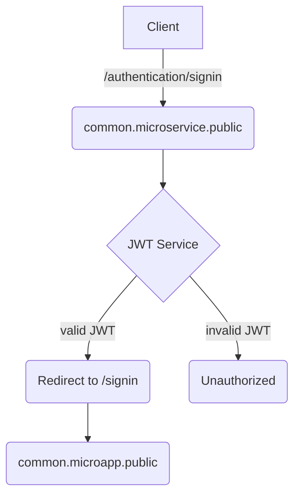

# common.microservice.public

A lightweight micro‑service framework built with **tsed** (TypeScript + Express) that provides a backend for frontend applications built with common.microapp.public.  
The service is split into three main layers:

| Layer | Purpose | Key files |
|-------|---------|-----------|
| **Middlewares** | Request/response handling, session cookie parsing, etc. | `middlewares/response.middleware.ts`, `middlewares/session.middleware.ts`, `middlewares/error.middleware.ts`, `middlewares/log.middleware.ts` |
| **Routes** | API endpoints | `routes/authentication.routes.ts`, `routes/configuration.routes.ts`, `routes/data.routes.ts`, `routes/health.routes.ts`, `/routes/organization.routes.ts`, `routes/system.routes.ts`, `routes/user.routes.ts` |
| **Services** | JWT, cookie, data, integrations, etc. | `services/abstract.service.ts`, `services/authorization.service.ts`, `services/configuration.service.ts`, `services/cookie.service.ts`, `services/data.service.ts`, `services/database.service.ts`, `services/jwt.service.ts`, |


## Getting Started

### Prerequisites

- Node.js ≥ 18
- npm or yarn
- A MongoDB database
- Environment variables

### Installation

```bash
# Clone the repo
git clone <repo-url>
cd <repo>/common.microservice.public

# Install dependencies
npm install
# or
yarn install

# Clone the child repository
git clone <repo-url> app
cd app

# Install dependencies
npm install
# or
yarn install

```

### Configuration

The `app/app.ts` file within the child repository is the configuration file that will be loaded and used. The `app.ts` file must follow the schema defined in `/custom_typings/app-config/index.d.ts`

> The `jwtCertificateFilePath` key must point to the location of the public key for the authority used to sign the JWT.


> The cookie domain is set using the `COOKIE_DOMAIN` environment variable.
> The cookie name can be specified using the `COOKIE_NAME` environment variable.
> The unauthorized redirect url can be specified using the `UNAUTHORIZED_REDIRECT` environment variable.
> The authorized redirect url can be specified using the `AUTHORIZED_REDIRECT` environment variable. This should be the hostname for your application.

### Running the Service

```bash
# Development (auto‑reload)
npm run dev
# or
yarn dev

# Production build
npm run build
npm start
```

The service will listen on the port defined in your `/app/app.ts` configuration (default `3500`).

## Authorization

Common.microservice.public requires and external authorization service in order to enforce security and RBAC. The integration to an external authorization service can be configured in the `microservices` section of the `app.ts`

```typescript
...
microservices: {
    authorization: {
    host: '127.0.0.1', 
    port: '9000',
    protocol: 'http'
    },
}
...
```
The authorization service must at a minimum support the following endpoints:


####  `GET`  /organization
Fetch an organization by id.

| Attribute | Type | Required | Description |
|-----------|------|----------|-------------|
|pkId|string|Yes|Organization identifier|
#### Response
```json
{
    "pkId": "string",
    "name": "string",
    "alias": "string",
    "createDate": "string",
    "updateDate": "string"
}
```

---

####  `POST`  /security/checkAccess
Check if a user has access to the requested resource.

| Attribute | Type | Required | Description |
|-----------|------|----------|-------------|
|applicationPkId|string|Yes|Application identifier|
|organizationPkId|string|Yes|Organization identifier|
|assetPkId|string|No|Asset identifier. Required when performing Asset check|
|rolePkId|string|No|Role identifier. Required when performing Role check|
|userPkId|string|Yes|User identifier. The user to check access for|
|checks|array|Yes|The type of check(s) to perform. Allowed checks: 'Role', 'Route', 'Asset'|
|parameters|object|No|The parameters used during the request|
|route|string|No|The route to check. Required when performing Route check|
|type|string|No|The type of route ('Server' or 'Client')| 
#### Response
```json
{
    "isPermissioned": "boolean",
}
```

####  `POST`  /security/jwt/renew
Renew a JWT

| Attribute | Type | Required | Description |
|-----------|------|----------|-------------|
|token|string|Yes|JWT|

#### Response
```json
{
    "token": "string",
}
```

---

####  `GET`  /security/role/get
Fetch a role by id.

| Attribute | Type | Required | Description |
|-----------|------|----------|-------------|
|pkId|string|Yes|Role identifier|
#### Response
```json
{
    "pkId": "string",
    "applicationPkId": "string",
    "organizationPkId": "string",
    "name": "string",
    "alias": "string",
    "description": "string",
    "isActive": "boolean",
    "createDate": "string",
    "updateDate": "string"
}
```

---
####  `GET`  /security/role/list
List roles by organization id.

| Attribute | Type | Required | Description |
|-----------|------|----------|-------------|
|organizationPkId|string|Yes|Organization identifier|
#### Response
```json
[
    {
        "pkId": "string",
        "applicationPkId": "string",
        "organizationPkId": "string",
        "name": "string",
        "alias": "string",
        "description": "string",
        "isActive": "boolean",
        "createDate": "string",
        "updateDate": "string"
    },
    ...
]
```

---
####  `POST`  /security/role/assign
Assign user to a role.

| Attribute | Type | Required | Description |
|-----------|------|----------|-------------|
|applicationPkId|string|Yes|Application identifier|
|organizationPkId|string|Yes|Organization identifier|
|rolePkId|string|Yes|Role identifier|
|userPkId|string|Yes|User identifier|
|assetPkId|string|No|Asset identifier|
#### Response
```
204 OK
```

---
####  `POST`  /security/role/unassign
Unassign user from a role.

| Attribute | Type | Required | Description |
|-----------|------|----------|-------------|
|applicationPkId|string|Yes|Application identifier|
|organizationPkId|string|Yes|Organization identifier|
|rolePkId|string|Yes|Role identifier|
|userPkId|string|Yes|User identifier|
|assetPkId|string|No|Asset identifier|
#### Response
```
204 OK
```

---
####  `POST`  /security/role/unassign
Unassign user from a role.

| Attribute | Type | Required | Description |
|-----------|------|----------|-------------|
|applicationPkId|string|Yes|Application identifier|
|organizationPkId|string|Yes|Organization identifier|
|rolePkId|string|Yes|Role identifier|
|userPkId|string|Yes|User identifier|
|assetPkId|string|No|Asset identifier|
#### Response
```
204 OK
```

---
####  `GET`  /user
Fetch a user by id.

| Attribute | Type | Required | Description |
|-----------|------|----------|-------------|
|pkId|string|Yes|User identifier|

#### Response
```json
{
    "pkId": "string",
    "firstName": "string",
    "lastName": "string",
    "middleName": "string",
    "email": "string",
    "cellPhone": "string",
    "workPhone": "string",
    "isActive": "boolean",
    "isSysAdmin": "boolean",

    "applications": [],
    "memberOf": [],

    "preference": {},
    "session": {"sessionId": "string"},

    "lastLogin": "string",
    "createDate": "string",
    "updateDate": "string",
}
```

---
####  `GET`  /user/index
Fetch the index of users.

| Attribute | Type | Required | Description |
|-----------|------|----------|-------------|
|||||

#### Response
```json
[
    {
        "pkId": "string",
        "firstName": "string",
        "lastName": "string",
        "isActive": "boolean",
    },
    ...
]

```

## Signin

To initialize the signin flow, `POST /authentication/signin` must be called with a JWT token present in the `token` body parameter. The `jwtCertificateFilePath` configuration item located in that applications `/app/app.ts` must be a file path pointing the the public key used to sign the token.





### Signin Request
####  `POST`  /authentication/signin
Initialize signin flow.

| Attribute | Type | Required | Description |
|-----------|------|----------|-------------|
|token|string|Yes|JWT|
#### Response
```
302 Found
```

### JWT Payload
```
    {
        jti: '8b091b31-df9c-4823-a5e6-f3780b1f40a9',
        aud: [
            'app://61c0aab7-7ad8-4f3a-b0f4-d41c7f2f6cdd', // application identifier
            'org://15a57d42-9fb6-4456-a27d-8eeb3248f691' // organization identifier
        ],
        roles: [ 'System Admin', 'Service Account', 'User' ],
        sub_id: { format: 'opaque', id: 'd2260f0a-e721-4d2f-afee-801810e047ae' }, // user identifier
        sub: 'tony.cicero@usai.io', // user email
        iat: 1773923967,
        exp: 1774010367,
        iss: 'United Solutions'
    }
```